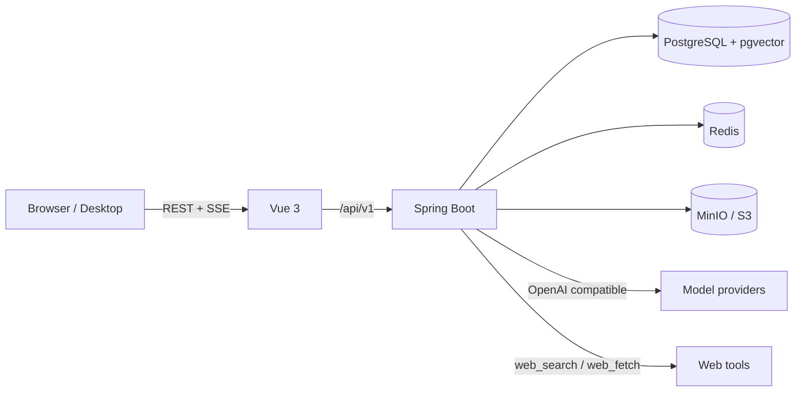

<div align="center">

# Cognia

**面向个人、团队与小型组织的自托管 RAG 知识库**

[](https://openjdk.org/projects/jdk/21/)
[](https://spring.io/projects/spring-boot)
[](https://vuejs.org/)
[](https://github.com/pgvector/pgvector)
[](LICENSE)

</div>

Cognia 把频道化文档、向量检索、OpenAI 兼容模型、工具调用、团队协作和运维后台整合为一个可自托管的系统。文档、模型、对象存储、SMTP、检索参数和提示词都由管理员在控制台配置，核心密钥加密后存入数据库。

## 功能概览

- **知识库频道**：个人或团队所有，支持公开/私密、多级文件夹、README 与 AGENT 说明文档。
- **文档处理**：PDF、DOCX、XLSX、PPTX、Markdown、TXT、HTML、CSV、JSON；图片型 PDF 自动 OCR 后切片、向量化。
- **RAG 对话**：可筛选频道、SSE 流式输出、思考过程、Function Calling、引用标记与原文预览。
- **模型接入**：任意 OpenAI 兼容端点；模型可见性、上下文窗口、思考/推理参数、Embedding 与 Rerank 均可在后台配置。
- **多用户协作**：用户/团队共享一级命名空间、团队角色、邀请、频道权限、通知与审计日志。
- **自托管运维**：S3/MinIO 对象存储、回收站、计划清理任务、缓存与上下文指标、管理员看板。

## 架构



后端按 `system`、`rag`、`security`、`common` 分包；前端位于 `cognia-ui`，使用 Vue 3、Vite、Tailwind CSS 与 shadcn-vue。

## Docker Compose 快速开始

前置条件：Docker 24+、Docker Compose v2，以及至少 4 GB 可用内存。

```bash
cp .env.example .env
# 修改 .env 中的数据库、JWT、SETTINGS_SECRET、管理员和 MinIO 密码
docker compose up -d --build
```

首次构建会编译后端并打包前端，完成后访问：

| 服务 | 地址 |
| --- | --- |
| Web | http://localhost:8088 |
| API | http://localhost:8080 |
| MinIO Console | http://localhost:9001 |
| PostgreSQL | localhost:5432 |
| Redis | localhost:6379 |

登录账号由 `.env` 的 `ADMIN_USERNAME` / `ADMIN_PASSWORD` 决定，默认是 `admin / Admin@123`，请立即修改。

### 首次配置

登录后进入控制台，至少完成对象存储和模型配置：

1. **对象存储**：Endpoint 填 `http://minio:9000`（容器内访问），Region 填 `us-east-1`，Bucket 填 `cognia`，AccessKey/SecretKey 使用 `.env` 中的 MinIO 账号，开启路径风格访问后执行连接测试。
2. **模型配置**：添加 OpenAI 兼容供应商，拉取模型并选择 Chat / Embedding / Rerank 模型。
3. **检索参数**：选择默认模型，按需调整切片、`top_k`、`top_n` 和重排。
4. **系统设置**：配置站点信息、注册策略、SMTP、上传类型与回收站留存期。

> 浏览器直连 MinIO 的预签名地址时，`minio:9000` 这个容器内域名不可解析。生产环境请把对象存储 Endpoint 换成浏览器可访问的公网/内网域名；本地如需直连预览，可让后端与 MinIO 使用同一可解析的主机名，或配置反向代理。

常用命令：

```bash
docker compose logs -f backend     # 查看后端日志
docker compose ps                  # 查看服务状态
docker compose down                # 停止，保留数据
docker compose down -v             # 停止并删除数据库/对象存储数据
```

## 本地开发

只用 Compose 启动基础设施：

```bash
docker compose up -d postgres redis minio minio-init
```

后端（JDK 21）：

```bash
export DB_URL=jdbc:postgresql://localhost:5432/cognia
export DB_USERNAME=cognia
export DB_PASSWORD=<与 compose 一致>
export REDIS_HOST=localhost
./mvnw spring-boot:run
```

前端（Node 22 + pnpm 11）：

```bash
cd cognia-ui
corepack enable
pnpm install
pnpm dev
```

开发地址为 http://localhost:5173，Vite 会把 `/api` 代理到 `http://localhost:8080`。后端启动时自动执行 `src/main/resources/db/schema.sql`，无需手动建表。

## 关键环境变量

| 变量 | 默认值 | 说明 |
| --- | --- | --- |
| `DB_URL` / `DB_USERNAME` / `DB_PASSWORD` | `localhost:5432/cognia` / `postgres` / `123456` | PostgreSQL |
| `REDIS_HOST` / `REDIS_PORT` | `localhost` / `6379` | Redis |
| `JWT_SECRET` | 开发内置值 | JWT 签名密钥，至少 32 字节 |
| `SETTINGS_SECRET` | 开发内置值 | 数据库密钥加密主密钥，变更后旧密钥无法解密 |
| `ADMIN_USERNAME` / `ADMIN_PASSWORD` / `ADMIN_EMAIL` | `admin` / `Admin@123` / `admin@cognia.local` | 初始管理员 |
| `CORS_ALLOWED_ORIGINS` | 本地开发地址 | 允许直接访问 API 的前端来源 |
| `MAIL_EXPOSE_CODE` | `false` | 是否在接口响应中返回邮箱验证码，仅开发使用 |
| `INIT_DATA_ENABLED` | `true` | 是否初始化角色、权限、管理员与默认数据 |
| `APP_TIME_ZONE` | `Asia/Shanghai` | 默认时区 |

对象存储、模型、检索、提示词、SMTP、注册策略与计划任务都在数据库/控制台中维护，不依赖环境变量。完整配置与接口说明见 [`docs/API.md`](docs/API.md)。

## 项目结构

```text
src/main/java/bao/gabriel/cognia/
  system/    用户、团队、频道、设置、通知、审计、存储、任务
  rag/       模型、检索、对话、工具、缓存
  security/  JWT、会话、权限、Turnstile
  common/    响应、异常、加密、文档解析、OCR
src/main/resources/db/schema.sql   幂等数据库结构
cognia-ui/                         Vue 3 前端
docker-compose.yml                 本地/单机部署
```

## 构建与测试

```bash
./mvnw -DskipTests compile                 # 后端编译
./mvnw test                                # 后端测试
cd cognia-ui && pnpm build                 # 前端类型检查 + 构建
```

桌面端打包使用 `cd cognia-ui && pnpm dist:desktop`，许可证与第三方声明会随安装包分发。

## 安全说明

- 生产环境必须修改 JWT、SETTINGS、数据库、MinIO 与管理员密码。
- 不要提交 `.env`、访问令牌、模型 API Key 或对象存储密钥。
- 上传类型、单文件大小、回收站留存期和团队权限均可在后台收紧。
- 公开部署建议在前端 Nginx 之外再加一层 HTTPS 反向代理，并限制数据库、Redis、MinIO 的端口暴露。

## 文档与许可

- API 与配置：[`docs/API.md`](docs/API.md)
- 第三方组件与许可：[`THIRD-PARTY-NOTICES.md`](THIRD-PARTY-NOTICES.md)
- 项目许可：[MIT](LICENSE)
