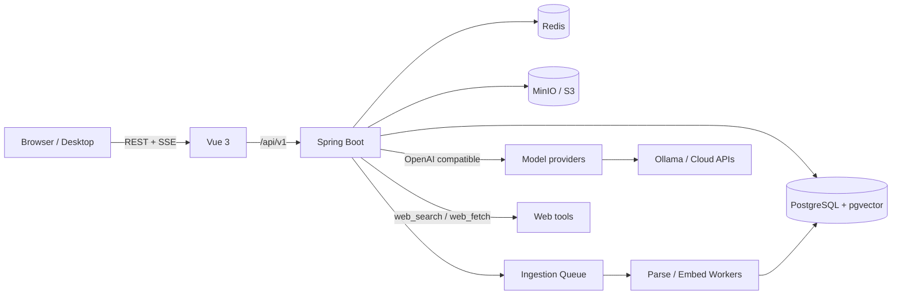

<div align="center">

# Cognia

**面向高校、年轻团队与新兴企业的自托管 RAG 知识库**

[](https://openjdk.org/projects/jdk/21/)
[](https://spring.io/projects/spring-boot)
[](https://vuejs.org/)
[](https://github.com/pgvector/pgvector)
[](LICENSE)

</div>

Cognia 把频道化文档、检索增强生成、模型接入、团队协作和运维后台整合为一个可自托管的系统。文档、向量、模型密钥、对象存储、SMTP、检索参数与提示词都在控制台维护，核心密钥加密后存入数据库。

它适合需要**数据不出域、模型可替换、知识库按组织/团队隔离**的场景：高校课题组、学生团队、初创公司与小型研发组织。

## 为什么是 Cognia

- **频道即知识边界**：个人频道与团队频道共用一级命名空间，公开/私密、成员角色、订阅与通知彼此独立。
- **从上传到可检索是一条完整链路**：解析、OCR、结构化切片、向量化、失败重试、死信处理与重新向量化都有记录。
- **模型不被绑定**：OpenAI 兼容端点、DeepSeek、通义、Ollama 本地模型都可以接入；切换 Embedding 模型时保留旧向量并提示频道重建。
- **回答可追溯**：引用标记、原文预览、全链路 Trace、回放与用户点赞/点踩，形成“反馈 → 聚合 → 人工复核”的质量闭环。
- **默认自托管**：PostgreSQL + pgvector、Redis、MinIO，一个 Compose 文件即可跑起来；不依赖外部 SaaS。

## 功能概览

### 知识库与文档

- 个人/团队频道，公开或私密；支持多级文件夹、频道归档、置顶、订阅与通知。
- README 作为频道说明渲染，AGENT 作为对话上下文注入；二者不参与向量化，`assets/` 图片按相对路径自动解析。
- 支持 PDF、DOCX、XLSX、PPTX、Markdown、TXT、HTML、CSV、JSON；图片型 PDF 自动 OCR。
- 文件管理器支持网格/列表、双击预览、面包屑、前进后退与 URL 文件夹路径。
- 删除默认进入回收站，按频道/时间筛选、恢复或永久删除；注销用户与解散团队的文件由清理任务级联处理。

### 检索与对话

- PostgreSQL + pgvector，HNSW 向量索引；检索按频道权限过滤，支持 `top_k` / `top_n` 与 Rerank。
- 关键词召回作为向量检索的补充；Rerank 失败不伪装成功，降级结果与错误会写入 Trace。
- SSE 流式输出、思考过程、Function Calling、`web_search` / `web_fetch`、引用标记与原文预览。
- `@` 提及频道、临时对话、对话归档、分叉、重新生成、编辑重发与消息级点赞/点踩。
- 支持上下文窗口、压缩阈值、语义缓存与检索缓存；页脚展示缓存命中率与上下文占用。

### 模型与处理链路

- OpenAI Chat / OpenAI Response / Anthropic Messages 协议；Ollama 本地 LLM、Embedding、Rerank。
- 模型可见性、上下文窗口、最大输出、视觉能力、思考档位均可在后台配置。
- 持久化文档处理队列：解析与向量化分阶段、Worker 租约、退避重试、死信重排、并发与队列上限可配。
- Embedding 失败不写入伪向量；失败原因进入健康度与告警，频道在处理完成前不会被检索命中。
- 图片可选用多模态模型生成结构化描述后再 Embedding；未配置时仅上传、不参与检索。

### 质量与运维

- 管理后台「质量评估」：按时间/反馈类型筛选点踩与点赞，下钻查看 Query、上下文、回答、检索与工具调用 Trace。
- 管理员可标注问题类型（幻觉、检索超时、答案不完整等）、填写备注并标记已处理。
- 审计日志覆盖管理员操作与计划任务；SSE 通知在线推送，离线补发未读消息。
- 队列深度、失败率、Embedding 健康度、检索延迟、模型 Token 与缓存命中率可在看板查看。
- 邮件服务独立配置：SMTP、模板、测试发信；频道管理员与订阅者可接收频道通知，运维告警可按角色发送。

## 架构



后端按 `system`、`rag`、`security`、`common` 分包；前端位于 `cognia-ui`，使用 Vue 3、Vite、Tailwind CSS 与 shadcn-vue。

## Docker Compose 快速开始

前置条件：Docker 24+、Docker Compose v2，以及至少 4 GB 可用内存。

```bash
cp .env.example .env
# 修改 .env 中的数据库、JWT、SETTINGS_SECRET、管理员和 MinIO 密码
docker compose up -d --build
```

首次构建会编译后端并打包前端，完成后访问：

| 服务 | 地址 |
| --- | --- |
| Web | http://localhost:8088 |
| API | http://localhost:8080 |
| MinIO Console | http://localhost:9001 |
| PostgreSQL | localhost:5432 |
| Redis | localhost:6379 |

登录账号由 `.env` 的 `ADMIN_USERNAME` / `ADMIN_PASSWORD` 决定，默认是 `admin / Admin@123`，请立即修改。

### 首次配置

登录后进入控制台，至少完成对象存储和模型配置：

1. **对象存储**：Endpoint 填 `http://minio:9000`（容器内访问），Region 填 `us-east-1`，Bucket 填 `cognia`，AccessKey/SecretKey 使用 `.env` 中的 MinIO 账号，开启路径风格访问后执行连接测试。
2. **模型配置**：添加 OpenAI 兼容供应商，拉取模型并选择 Chat / Embedding / Rerank 模型；Embedding 维度必须与知识库一致。
3. **检索参数**：选择默认模型，按需调整切片、`top_k`、`top_n`、重排、上下文压缩与缓存。
4. **系统设置**：配置站点信息、注册策略、SMTP、上传类型、回收站留存期与计划任务。

> 浏览器直连 MinIO 的预签名地址时，`minio:9000` 这个容器内域名不可解析。生产环境请把对象存储 Endpoint 换成浏览器可访问的公网/内网域名；本地如需直连预览，可让后端与 MinIO 使用同一可解析的主机名，或配置反向代理。

### 可选：本地 Ollama

Ollama 不参与默认启动，只有需要本地模型时才启用：

```bash
# .env 中设置容器内地址
OLLAMA_BASE_URL=http://ollama:11434

# 启动 Ollama（可选 profile）
docker compose --profile ollama up -d ollama
docker compose up -d backend
```

后端检测到 `OLLAMA_BASE_URL` 且尚无 Ollama 供应商时，会自动创建并启用 `Ollama（本地）` 供应商；后台「模型配置」页即可查看连接状态、拉取本地模型。连接已有的外部 Ollama 时，把 `OLLAMA_BASE_URL` 指向其地址后重启后端，或在页面手动添加供应商。

常用命令：

```bash
docker compose logs -f backend     # 查看后端日志
docker compose ps                  # 查看服务状态
docker compose down                # 停止，保留数据
docker compose down -v             # 停止并删除数据库/对象存储数据
```

## 本地开发

只用 Compose 启动基础设施：

```bash
docker compose up -d postgres redis minio minio-init
```

后端（JDK 21）：

```bash
export DB_URL=jdbc:postgresql://localhost:5432/cognia
export DB_USERNAME=cognia
export DB_PASSWORD=<与 compose 一致>
export REDIS_HOST=localhost
./mvnw spring-boot:run
```

前端（Node 22 + pnpm 11）：

```bash
cd cognia-ui
corepack enable
pnpm install
pnpm dev
```

开发地址为 http://localhost:5173，Vite 会把 `/api` 代理到 `http://localhost:8080`。后端启动时自动执行 `src/main/resources/db/schema.sql`，无需手动建表。

## 关键环境变量

| 变量 | 默认值 | 说明 |
| --- | --- | --- |
| `DB_URL` / `DB_USERNAME` / `DB_PASSWORD` | `localhost:5432/cognia` / `postgres` / `123456` | PostgreSQL |
| `REDIS_HOST` / `REDIS_PORT` | `localhost` / `6379` | Redis |
| `JWT_SECRET` | 开发内置值 | JWT 签名密钥，至少 32 字节 |
| `SETTINGS_SECRET` | 开发内置值 | 数据库密钥加密主密钥，变更后旧密钥无法解密 |
| `ADMIN_USERNAME` / `ADMIN_PASSWORD` / `ADMIN_EMAIL` | `admin` / `Admin@123` / `admin@cognia.local` | 初始管理员 |
| `CORS_ALLOWED_ORIGINS` | 本地开发地址 | 允许直接访问 API 的前端来源 |
| `MAIL_EXPOSE_CODE` | `false` | 是否在接口响应中返回邮箱验证码，仅开发使用 |
| `INIT_DATA_ENABLED` | `true` | 是否初始化角色、权限、管理员与默认数据 |
| `APP_TIME_ZONE` | `Asia/Shanghai` | 默认时区 |
| `OLLAMA_BASE_URL` | 空 | 可选，指向本地/外部 Ollama 的 `http://host:11434` |

对象存储、模型、检索、提示词、SMTP、注册策略与计划任务都在数据库/控制台中维护，不依赖环境变量。完整配置与接口说明见 [`docs/API.md`](docs/API.md)。

## 项目结构

```text
src/main/java/bao/gabriel/cognia/
  system/    用户、团队、频道、设置、通知、审计、存储、邮件、任务
  rag/       模型、检索、对话、工具、缓存、反馈、文档处理队列
  security/  JWT、会话、权限、Turnstile
  common/    响应、异常、加密、文档解析、OCR、结构化切片
src/main/resources/db/schema.sql   幂等数据库结构
cognia-ui/                         Vue 3 前端
docker-compose.yml                 本地/单机部署
```

## 构建与测试

```bash
./mvnw -DskipTests compile                 # 后端编译
./mvnw test                                # 后端测试
cd cognia-ui && pnpm build                 # 前端类型检查 + 构建
```

桌面端打包使用 `cd cognia-ui && pnpm dist:desktop`，许可证与第三方声明会随安装包分发。

## 安全说明

- 生产环境必须修改 JWT、SETTINGS、数据库、MinIO 与管理员密码。
- 不要提交 `.env`、访问令牌、模型 API Key 或对象存储密钥。
- 上传类型、单文件大小、回收站留存期和团队权限均可在后台收紧。
- 公开部署建议在前端 Nginx 之外再加一层 HTTPS 反向代理，并限制数据库、Redis、MinIO 的端口暴露。
- 第三方登录、2FA 与 OIDC 由管理员按需启用；未配置时不会暴露入口。

## 文档与许可

- API 与配置：[`docs/API.md`](docs/API.md)
- 第三方组件与许可：[`THIRD-PARTY-NOTICES.md`](THIRD-PARTY-NOTICES.md)
- 项目许可：[MIT](LICENSE)
