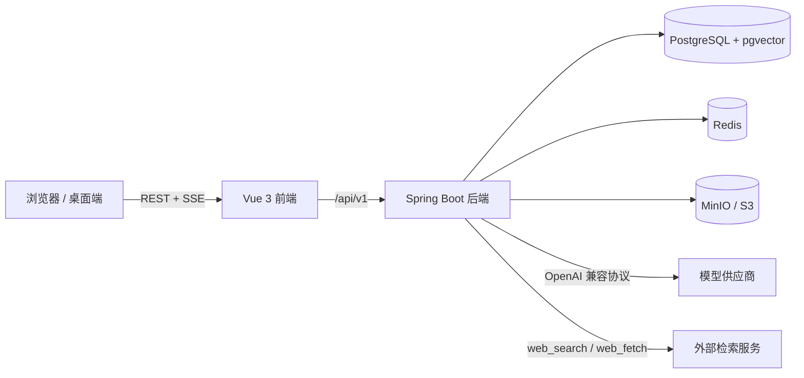

<div align="center">

# Cognia

**Cognia 是一个专为高校、年轻团队和新兴企业打造的 RAG 知识库 SaaS 平台**

[](https://openjdk.org/projects/jdk/21/)
[](https://spring.io/projects/spring-boot)
[](https://vuejs.org/)
[](https://github.com/pgvector/pgvector)
[](LICENSE)

[功能特性](#功能特性) · [快速开始](#快速开始) · [配置](#配置) · [架构](#架构) · [开发](#开发) · [部署](#部署) · [贡献](#贡献)

</div>

Cognia 将频道化文档管理、向量检索、OpenAI 兼容模型接入、工具调用、团队协作与后台运维整合为一个可自托管的系统。用户可以在个人空间或团队空间内建立频道、组织文档并进行带权限过滤的知识库对话。

项目采用前后端分离架构：后端基于 Spring Boot 与 Spring AI，前端基于 Vue 3 与 shadcn-vue。模型供应商、对象存储、SMTP、检索参数、提示词与计划任务均可在管理控制台中配置，核心密钥使用 AES-GCM 加密后落库。

---

## 功能特性

### 知识库与频道

- **个人 / 团队频道**：频道归属于个人或团队，支持公开与私密两种可见性。
- **多级文件夹**：默认最多 5 层，可在系统设置中调整；支持向指定文件夹上传文档。
- **频道说明文档**：`README.md` 渲染在频道页底部；`AGENT.md` 支持 frontmatter（`name`、`description`、`tags`），用于描述频道结构与检索规则。
- **文档上传**：支持多文件上传、上传进度、标题、文档类型与时效时间；上传后自动执行解析、切片与向量化。
- **文档解析**：PDF、DOCX、XLSX、PPTX、Markdown、TXT、HTML、CSV、JSON。旧版 `.doc`、`.xls`、`.ppt` 暂不支持自动解析。
- **逻辑删除与回收站**：删除文档时保留对象存储文件并写入回收站，到达留存期后由计划任务清理。
- **回收站管理**：个人所有者或团队成员可查看回收站并手动永久清理。

### RAG 与模型

- **OpenAI 兼容供应商**：后台可添加任意兼容 Chat Completions 的 API 端点与密钥。
- **模型发现与可见性**：填写端点与 Key 后可拉取 `/models`，管理员选择启用哪些模型对普通用户可见。
- **模型级参数**：支持工具调用、思考模式、推理强度与自定义 `extra_body`；内置 DeepSeek、Qwen 等兼容参数的适配。
- **向量与重排模型**：分别配置 Embedding 与 Rerank 模型；向量维度可随模型动态调整。
- **检索流程**：向量召回 `top_k`（默认 20）→ 可选重排 → 取 `top_n`（默认 5）→ 组装上下文。
- **权限过滤**：检索 SQL 与 `kb_channel` 联表，仅召回公开频道、本人频道或本人所属团队的频道。
- **切片配置**：`chunk_size`、`chunk_overlap` 可在系统设置中调整。
- **切片元数据**：包含文件名、页码、切片 ID、序号、文本哈希、原文、版本、文档 ID、频道 ID、拥有者、S3 路径、文档类型、标题、作者、向量模型与过期时间。
- **时效性**：文档可标记过期时间；过期片段仍可召回，但会携带 `is_expired` / `expiration_time`，提示词要求模型注明时效。
- **提示词配置**：系统提示词、RAG 规则、过期提示与工具规则均可在后台维护。

### AI 对话

- **SSE 流式输出**：文本、思考过程与工具调用状态实时推送。
- **Function Calling**：内置 `web_search` 与 `web_fetch`，按 OpenAI 工具协议实现；支持多轮工具调用。
- **会话历史**：会话与消息持久化，支持按频道筛选、恢复历史与会话自动命名。
- **随机会话 ID**：会话对外使用随机 `public_id`，不暴露数据库自增主键。
- **模型与频道选择**：用户只能使用管理员开放的模型，并可在提问时选择知识库频道。

### 协作与身份

- **统一命名空间**：用户与团队共用一级路由 `/{username}` 或 `/{teamSlug}`；用户名/团队标识全局唯一。
- **团队主页**：团队介绍、频道、成员与设置全部在 `/{teamSlug}` 内，不再使用 `/teams/{id}`；团队列表、创建与邀请处理位于 `/settings/teams`。
- **保留字保护**：`login`、`settings`、`admin`、`notifications`、`explore`、`api`、`about` 等系统路由不能注册为用户名或团队标识。
- **个人主页**：双栏布局，展示头像、昵称、用户名、简介、企业、家乡、时区、邮箱、自定义链接、勋章、公开团队、README、置顶频道与公开频道。
- **团队角色**：所有者（OWNER）、管理者（MANAGER）、编辑者（EDITOR）、成员（MEMBER），分别控制团队设置、文档编辑与只读访问。
- **团队管理**：控制台提供团队列表与解散操作；团队解散后进入计划任务清理流程。

### 平台与运维

- **对象存储**：兼容 S3 的单桶存储，支持 MinIO、AWS S3、Cloudflare R2 等；端点、区域、Bucket、AccessKey、SecretKey、路径风格与公网地址均存数据库。
- **上传能力**：普通上传、分片上传、进度回调、自定义 key 前缀；不做断点续传。
- **临时文件**：`tmp/` 前缀用于多模态临时文件；通过 S3/MinIO 生命周期规则自动过期。
- **审计日志**：记录管理员与登录用户的写操作，包含操作者、模块、动作、资源、方法、路径、IP、UA、耗时与错误信息；敏感字段自动脱敏。
- **通知中心**：在线时通过 SSE 实时推送；离线时写入 `notification` 表，并在下次登录或连接 SSE 时补发未读消息。
- **预设计划任务**：文档超时巡检、残留分片清理、回收站清理、注销用户/团队文件清理、`tmp/` 生命周期同步；管理员可配置启用状态、Cron、阈值、留存期与批量大小，但不支持自定义任务。
- **账号与团队注销**：注销后禁止登录与访问；用户名/团队标识保留到清理完成，避免提前被重新注册。

### 安全与合规

- JWT Access/Refresh 双令牌 + Redis 会话白名单；登出、改密、禁用、角色变更后立即失效。
- RBAC 细粒度权限，接口级 `@PreAuthorize`，前端路由与操作按钮同步控制。
- BCrypt 密码哈希、登录失败锁定、邮箱验证码、Cloudflare Turnstile。
- SMTP 密码、Turnstile Secret、对象存储 SecretKey、模型 API Key、云搜索 Key 均使用 AES-GCM 加密存储。
- 隐私政策、用户协议与开源许可版本化；协议更新后强制全站用户重新同意。
- 上传类型、单文件大小、文件夹深度、回收站留存期等均可在后台配置。

---

## 技术栈

| 层次 | 技术 |
| --- | --- |
| 后端 | Java 21、Spring Boot 4.1、Spring Security、Spring AI 2.0 |
| 数据访问 | MyBatis-Plus 3.5、PostgreSQL + pgvector、Redis |
| 对象存储 | MinIO Java SDK、AWS S3 SDK，兼容 S3 协议 |
| 认证 | JWT、Redis 会话、BCrypt、Turnstile |
| 文档解析 | Apache PDFBox 2.0、Apache POI 5.2 |
| 前端 | Vue 3.5、TypeScript 5.7、Vite 8、Pinia 4、Vue Router 5 |
| UI | Tailwind CSS 4、shadcn-vue、Reka UI、Tabler Icons、AI Elements 风格组件 |
| 构建 | Maven Wrapper、pnpm |

---

## 架构



- **`system`**：认证、用户、角色、团队、频道、设置、通知、审计、对象存储与计划任务。
- **`rag`**：模型管理、检索、Embedding、重排、对话、工具调用与会话历史。
- **`common`**：统一响应、异常、加密、对象存储工具与 OpenAI 兼容 HTTP 客户端。
- **`security`**：JWT、会话、权限快照、Turnstile 与安全工具。

---

## 快速开始

### 环境要求

| 依赖 | 版本 |
| --- | --- |
| JDK | 21 |
| Node.js | 22 LTS（最低 20.19） |
| pnpm | 9+ |
| PostgreSQL | 16+，需安装 `pgvector` 扩展 |
| Redis | 6+ |
| MinIO / S3 | 可选，但文件上传与知识库功能需要 |

### 1. 准备基础设施

```bash
# PostgreSQL + pgvector
docker run -d --name cognia-pg \
  -p 5432:5432 \
  -e POSTGRES_PASSWORD=123456 \
  -e POSTGRES_DB=cognia \
  pgvector/pgvector:pg18

docker exec cognia-pg psql -U postgres -d cognia \
  -c 'CREATE EXTENSION IF NOT EXISTS vector;'

# Redis
docker run -d --name cognia-redis -p 6379:6379 redis:7-alpine

# MinIO
docker run -d --name cognia-minio \
  -p 9000:9000 -p 9001:9001 \
  -e MINIO_ROOT_USER=minioadmin \
  -e MINIO_ROOT_PASSWORD=minioadmin \
  -v cognia-minio:/data \
  minio/minio server /data --console-address ':9001'
```

在 MinIO 控制台（`http://localhost:9001`）创建 Bucket，例如 `cognia`。

### 2. 启动后端

```bash
export JAVA_HOME=/path/to/jdk-21
./mvnw spring-boot:run
```

默认监听 `http://localhost:8080`。首次启动会自动执行 `src/main/resources/db/schema.sql`，并初始化：

- 角色 `ADMIN` / `USER`
- 26 项细粒度权限
- 默认站点设置、法律条款与邮件模板
- 管理员账号 `admin / Admin@123`

> 生产环境必须通过环境变量修改默认管理员密码与密钥。

### 3. 启动前端

```bash
cd cognia-ui
corepack enable
pnpm install
pnpm dev
```

访问 `http://localhost:5173`。Vite 已将 `/api` 代理到 `http://localhost:8080`。

### 4. 首次配置

使用管理员账号登录后，进入控制台完成以下配置：

1. **对象存储**：填写 Endpoint、Region、Bucket、AccessKey、SecretKey，开启路径风格访问（MinIO），执行连接测试。
2. **模型配置**：添加 OpenAI 兼容供应商，拉取模型列表，选择启用并对用户可见的 Chat / Embedding / Rerank 模型。
3. **检索参数**：选择默认 Chat 模型、Embedding 模型，按需开启 Rerank，设置 `chunk_size`、`chunk_overlap`、`top_k`、`top_n`。
4. **Prompt 配置**：按需调整系统提示词、RAG 规则、过期提示与工具规则。
5. **系统设置**：配置站点信息、注册策略、SMTP、上传类型、文件夹深度与回收站留存期。

---

## 配置

### 环境变量

以下配置位于 `src/main/resources/application.yaml`，均支持环境变量覆盖：

| 变量 | 默认值 | 说明 |
| --- | --- | --- |
| `SERVER_PORT` | `8080` | 服务端口 |
| `DB_URL` | `jdbc:postgresql://localhost:5432/cognia` | PostgreSQL JDBC URL |
| `DB_USERNAME` / `DB_PASSWORD` | `postgres` / `123456` | 数据库账号 |
| `REDIS_HOST` / `REDIS_PORT` / `REDIS_DATABASE` | `localhost` / `6379` / `0` | Redis |
| `JWT_SECRET` | 开发内置值 | JWT 签名密钥，生产必须覆盖，长度 ≥ 32 字节 |
| `JWT_ACCESS_EXPIRATION` | `30m` | Access Token 有效期 |
| `JWT_REFRESH_EXPIRATION` | `7d` | Refresh Token 有效期 |
| `JWT_REMEMBER_ME_EXPIRATION` | `30d` | “记住我” Refresh Token 有效期 |
| `CORS_ALLOWED_ORIGINS` | `http://localhost:5173,...` | 允许的前端来源，逗号分隔 |
| `SETTINGS_SECRET` | 开发内置值 | 数据库密钥加密主密钥，长度 ≥ 32 字符，生产必须覆盖 |
| `APP_TIME_ZONE` | `Asia/Shanghai` | 默认时区 |
| `MAIL_EXPOSE_CODE` | `true` | 是否在接口响应中返回验证码，生产必须设为 `false` |
| `INIT_DATA_ENABLED` | `true` | 是否执行启动初始化 |
| `ADMIN_USERNAME` / `ADMIN_PASSWORD` / `ADMIN_EMAIL` | `admin` / `Admin@123` / `admin@cognia.local` | 初始管理员 |
| `OPENAI_API_KEY` | 占位值 | Spring AI 兜底配置；业务模型请使用控制台中的数据库配置 |

### 数据库运行时配置

以下内容不再依赖配置文件，统一保存在数据库中：

- 站点品牌、注册与登录策略、SMTP、Turnstile、上传类型、文件夹深度、回收站留存期
- 对象存储端点、Bucket、AccessKey、SecretKey、公网地址与生命周期保留天数
- OpenAI 兼容供应商、模型可见性、思考/推理参数、Embedding 与 Rerank 选择
- 检索参数、切片参数、系统提示词
- 通知、审计、计划任务与会话历史

`SETTINGS_SECRET` 变更后，已加密的 Key 将无法解密，需要重新填写。

### 权限模型

系统内置 `ADMIN` 与 `USER` 角色，权限按 API 与菜单划分：

| 领域 | 权限 |
| --- | --- |
| 控制台 | `console:access` |
| 用户 | `user:read`、`user:create`、`user:update`、`user:delete`、`user:assign-role`、`user:reset-password` |
| 角色与权限 | `role:read`、`role:create`、`role:update`、`role:delete`、`role:assign-permission`、`permission:read` |
| 系统设置 | `settings:read`、`settings:update` |
| 对象存储 | `storage:read`、`storage:update` |
| 审计与任务 | `audit:read`、`task:read`、`task:update` |
| 团队管理 | `team:read`、`team:update` |
| 模型与检索 | `model:read`、`model:update`、`rag:read`、`rag:update` |

`ADMIN` 启动时自动同步全部权限；`ADMIN` / `USER` 角色不可删除。团队内部权限独立于系统 RBAC，由团队角色控制。

---

## 目录结构

```text
cognia/
├── src/main/java/bao/gabriel/cognia/
│   ├── common/                  # 统一响应、异常、加密、存储、AI HTTP 客户端
│   ├── config/                  # Security、WebMvc、调度、MyBatis-Plus、属性配置
│   ├── security/                # JWT、会话、过滤器、权限工具、Turnstile
│   ├── system/
│   │   ├── controller/          # 认证、用户、角色、团队、频道、设置等接口
│   │   ├── dto/                 # 请求 / 响应模型
│   │   ├── entity/              # 数据库实体
│   │   ├── mapper/              # MyBatis-Plus Mapper
│   │   ├── service/             # 业务服务
│   │   └── task/                # 预设计划任务处理器
│   └── rag/
│       ├── service/             # 检索、Embedding、对话、工具与向量化
│       └── dto/                 # 检索与对话 DTO
├── src/main/resources/
│   ├── application.yaml
│   └── db/schema.sql            # 幂等数据库脚本，每次启动执行
├── cognia-ui/
│   └── src/
│       ├── api/                 # Axios 接口模块
│       ├── components/          # 通用组件、AI Elements 与 shadcn-vue
│       ├── pages/               # 聊天、主页、频道、控制台页面
│       ├── router/              # 路由与权限守卫
│       ├── stores/              # Pinia
│       └── types/               # TypeScript 类型
├── docs/API.md                  # 核心接口说明
└── scripts/smoke-test.sh        # 认证与 RBAC 冒烟脚本
```

---

## 开发

### 常用命令

```bash
# 后端编译
./mvnw -DskipTests compile

# 后端测试
./mvnw test

# 后端打包
./mvnw -DskipTests package

# 前端类型检查与构建
cd cognia-ui
pnpm build

# 前端开发服务器
pnpm dev
```

### 开发约定

- 数据库脚本必须保持幂等，使用 `CREATE TABLE IF NOT EXISTS`、`ADD COLUMN IF NOT EXISTS` 与 `ON CONFLICT DO NOTHING`。
- 新增接口遵循 `/api/v1`、统一 `ApiResponse` 包裹与 `BusinessException` 错误语义。
- 后端权限使用 `@PreAuthorize`，前端同步补充 `meta.permissions` 与操作级权限判断。
- 新增加密配置必须使用 `SecurityCryptoService`，接口只返回 `xxxConfigured` 布尔值，不返回明文。
- 前端页面保持与 `pages/console/System.vue` 一致的结构：页头、卡片分区、字段栅格、加载态、空状态与权限提示。
- 修改 DTO 时同步更新 `cognia-ui/src/types/api.ts` 与对应的 `src/api/*.ts`。
- 涉及 SSE 的变更需验证流式增量、工具事件与异步调度权限。

使用 AI 辅助开发时，请遵循仓库根目录的 `AGENT.md` 中的协作约定。该文件为本地开发说明，已加入 `.gitignore`，不随仓库分发。

---

## 部署

### 构建

```bash
./mvnw -DskipTests package
cd cognia-ui && pnpm build
```

后端产物位于 `target/`，前端静态文件位于 `cognia-ui/dist/`。

### 运行

```bash
java -jar target/cognia-0.0.1-SNAPSHOT.jar
```

建议使用 Nginx 托管前端并反向代理 API：

```nginx
location /api/ {
    proxy_pass http://127.0.0.1:8080;
    proxy_http_version 1.1;
    proxy_set_header Host $host;
    proxy_set_header X-Real-IP $remote_addr;
    proxy_set_header X-Forwarded-For $proxy_add_x_forwarded_for;

    # SSE 必须关闭缓冲
    proxy_buffering off;
    proxy_cache off;
    proxy_read_timeout 3600s;
}

location / {
    root /var/www/cognia;
    try_files $uri $uri/ /index.html;
}

client_max_body_size 520m;
```

### 安全清单

- [ ] 覆盖 `JWT_SECRET` 与 `SETTINGS_SECRET`，长度满足要求且不进入版本库。
- [ ] 修改默认管理员密码，或关闭初始化后手工创建管理员。
- [ ] 设置 `MAIL_EXPOSE_CODE=false`。
- [ ] 将 `CORS_ALLOWED_ORIGINS` 限制为真实前端域名。
- [ ] 使用最小权限数据库账号，并为 Redis 配置访问控制。
- [ ] 全站启用 HTTPS，确保 `Authorization` 与 SSE 请求不被明文传输。
- [ ] 限制 `web_fetch` 的出站网络访问，避免访问内网元数据或管理接口。
- [ ] 为上传目录与对象存储配置配额、生命周期与备份策略。
- [ ] 定期轮换模型与存储密钥；轮换 `SETTINGS_SECRET` 后重新填写所有加密配置。

> 安全提示：RAG 召回内容与外部网页属于不可信输入，提示词约束不能完全消除提示注入风险。生产环境应结合工具白名单、出站网络策略与审计日志使用。

---

## 限制

- 旧版二进制 Office 格式（`.doc`、`.xls`、`.ppt`）暂不支持自动解析。
- 上传不提供断点续传；大文件依赖分片上传与网络稳定性。
- Ollama 本地模型适配尚未实现，当前以 OpenAI 兼容接口为准。
- 计划任务仅支持内置任务，不支持用户自定义脚本。
- `web_fetch` 具备访问外部 URL 的能力，部署时必须配合出站网络限制。

---

## 贡献

欢迎通过 Issue 与 Pull Request 参与改进。提交前请确认：

1. 后端 `./mvnw -DskipTests compile` 通过。
2. 前端 `pnpm build` 通过。
3. 数据库脚本可重复执行。
4. 新增或修改的接口已补充权限控制与前端类型。
5. 不提交任何密钥、Token、个人配置或本地开发说明。

---

## License

本项目基于 [MIT License](LICENSE) 开源。
